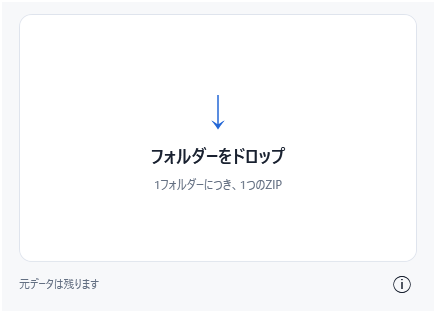

# 1Folder1Zip

フォルダーをドロップするだけで、**1フォルダーにつき1つのZIP**を作成するWindowsアプリです。

**バージョン 1.0.0 · Windows 10 / 11 x64 · MIT · 開発者 @nstation**



日本語／英語の表示に対応しています。[English overview](#english-overview)

## 特長

- 複数のフォルダーをドロップすると、各フォルダーの隣に「フォルダー名.zip」を作成します。元のフォルダーは残ります。
- ZIP内にはフォルダー自身ではなく、その**中身**を格納します。
- 既存のZIPは上書きしません。同名がある場合は `名前 (1).zip`、`名前 (2).zip` と連番で保存します。
- インストール、管理者権限、.NETの事前インストールは不要です。EXE単体で動作します。
- 設定・履歴・ログファイルは保存しません。

## ダウンロード

[Releases](https://github.com/nstation/1Folder1Zip/releases) から配布ZIPを取得し、展開して `1Folder1Zip.exe` を起動してください。配布ZIPにはライセンスと第三者の告知も含まれます。

配布ZIPに添付された `SHA256SUMS.txt` で、ダウンロードしたファイルを確認できます。EXEにコード署名は付いていないため、初回起動時にWindows SmartScreenの警告が表示される場合があります。

ソースからビルドする場合は、[ビルドと検証](#ビルドと検証) を参照してください。

## 使い方

1. `1Folder1Zip.exe` を起動し、ウィンドウに複数のフォルダーをドロップします。ドロップすると自動的に圧縮を開始します。
2. 各フォルダーの隣にZIPが作成されます。「詳細を表示」で個別の結果を確認できます。
3. 処理後に「クリア」を押すと、結果の履歴を破棄して初期画面に戻ります。

EXEのアイコンへ直接フォルダーをドロップして起動することもできます。その場合、全件が成功すると自動で終了します。エラーやキャンセルがあるときは、結果を確認できるよう終了しません。通常のファイルだけをドロップした場合は、案内を表示します。

処理中や結果表示中も、追加のフォルダーをドロップできます。画面下部の ⓘ からバージョンと開発者情報を確認できます。

## 主な機能

- ZIP / Deflate、ZIP64、UTF-8の名前、空フォルダー、DOS属性、ファイル更新日時。
- フォルダー単位の並列圧縮、バックグラウンドスキャン、追加ドロップ、同じフォルダーの重複投入の除外。
- CPU使用率、メモリ負荷、ディスク稼働率を参照した並列数の調整。圧縮処理は低い優先度で実行します。
- 出力先ボリュームごとの空き容量の予約。予約済み容量が原因で開始できない場合は、実行中のジョブを待ちます。
- 128KBバッファによるストリーミング圧縮。一意な隠し一時ファイルへ書き込み、上書きしない名前変更で確定します。
- シンボリックリンク、ジャンクション、対応外の再解析ポイントは除外します。Windows Cloud Filesのプレースホルダーは、プロバイダーを通して読み取ります。
- 一括キャンセル。エラーはフォルダーごとに扱い、フルパス・HRESULT・技術的な詳細を表示してコピーできます。
- 一時的なネットワーク障害は、5秒間隔で最大3回再試行します。再試行時は、そのフォルダーを先頭から圧縮し直します。
- 多重起動の制御（名前付きミューテックスと、現在のユーザーに限定した名前付きパイプ）。
- ライト／ダークテーマへの追従、タスクバーの進捗表示、圧縮中の自動スリープ抑止。
- 最小化中に全処理が完了したときは、Windowsに無音の通知を要求します。トレイには常駐しません。
- 高DPI対応（Per-Monitor V2）。初期ウィンドウサイズ 450×350 は論理ピクセルです。[MicrosoftのDPI設定仕様](https://learn.microsoft.com/en-us/windows/win32/hidpi/setting-the-default-dpi-awareness-for-a-process)

## 制約・注意事項

- ZIPの日時は2秒精度で、表現できる範囲は1980〜2107年です。範囲外の日時は端の値に丸めます。
- 属性の復元結果は、解凍ソフトに依存します。NTFSのACL、所有者情報、代替データストリーム（ADS）は保存しません。
- ZIPは暗号化・パスワード保護に対応していません。完成後の再検証も行いません。
- 空き容量の判定には、非圧縮容量とZIPヘッダーなどから算出した保守的な見積もりを使います。圧縮中に入力が変更されると、スキャン結果と実際のサイズが異なることがあります。
- NASなど、OSによるファイルアクセス中は、キャンセルの反映に時間がかかる場合があります。
- 異常終了後の一時ファイルは、EXEのあるディレクトリと、新たに投入されたフォルダーの出力先だけを対象に清掃します。名前・所有プロセス・隠し属性・ZIP署名を確認し、確認できないものは削除しません。
- 単一EXEには.NETランタイムが含まれます。起動時に.NET自身がネイティブライブラリをユーザーの一時ディレクトリへ展開することがありますが、アプリの設定や履歴ではありません。[Microsoftの単一ファイル配布仕様](https://learn.microsoft.com/en-us/dotnet/core/deploying/single-file/overview)
- 対象はWindows 10 / 11 x64です。.NET 10のOSサポート範囲は、[Microsoftの一覧](https://learn.microsoft.com/en-us/dotnet/core/install/windows)に従います。
- 実機での検証が済んでいない項目があります。詳細は [VALIDATION.md](VALIDATION.md) を参照してください。

本ソフトウェアは、MITライセンスに基づき無保証で提供されます。重要なデータを扱う場合は、元のフォルダーが残っていることを確認してからご利用ください。

## ビルドと検証

Windows x64、.NET 10 SDK、PowerShell 7 を使用します。SDKは `global.json` で.NET 10の安定版を選択します。外部ZIPソフトや追加のNuGetライブラリは使用しません。自己完結型EXEの初回発行時には、Microsoftのランタイムパックを NuGet から取得します。

```powershell
.\build.ps1                    # Releaseビルド
.\build.ps1 -Test              # 圧縮処理・WPFのテスト
.\build.ps1 -Test -Publish     # テスト後、単一EXEを生成（artifacts/win-x64/1Folder1Zip.exe）
.\build.ps1 -Test -Package     # テスト後、ライセンス付き配布ZIPを生成（artifacts/releases/）
.\build.ps1 -Stress            # 10万ファイルと4GB超を追加検証
.\tools\Test-Launch.ps1        # 発行したEXEの起動・多重起動転送を検証
```

ストレステストは、テスト用出力ディレクトリ内に一時的に10万ファイルと4GB超のファイルを作成し、終了時に削除します。十分な空き容量が必要です。ジャンクションの作成を禁止する環境では、一部のテストを実行できません。

| 場所 | 内容 |
| --- | --- |
| `src/OneFolderOneZip.Core` | 列挙、ZIP作成、容量予約、処理キュー、WindowsファイルAPI |
| `src/OneFolderOneZip.App` | WPF画面、起動制御、テーマ、通知 |
| `tests/OneFolderOneZip.Tests` | 依存ライブラリ不要の圧縮・キューテスト |
| `tests/OneFolderOneZip.UiTests` | WPFの表示・ドロップ・完了・詳細・クリアのテスト |
| `tools/New-Icon.ps1` | コードで描画したフォルダー／ZIPアイコンの再生成 |
| `tools/New-Release.ps1` | EXE・ライセンス・告知を配布ZIPにまとめる |

GitHub Actionsでビルド・テスト・配布ZIPの生成を行う設定を含みます。

## ドキュメント

- [仕様書](1Folder1Zip_仕様書_v1.0.0.md)
- [検証記録と未検証項目](VALIDATION.md)
- [変更履歴](CHANGELOG.md)
- [開発への参加](CONTRIBUTING.md)
- [第三者コンポーネントのライセンス](THIRD_PARTY_NOTICES.md)

不具合や要望は [Issues](https://github.com/nstation/1Folder1Zip/issues) へお寄せください。

## ライセンス

[MIT License](LICENSE) — Copyright (c) 2026 @nstation

同梱する.NETランタイムの告知は、[第三者コンポーネントのライセンス](THIRD_PARTY_NOTICES.md)を参照してください。

## English overview

1Folder1Zip is a portable Windows x64 application that creates one ZIP file for each dropped folder.

- Drop one or more folders onto the window. A ZIP named after each folder is created next to it, and the original folders are kept.
- The ZIP contains the folder's contents, not the folder itself.
- Existing files are never overwritten; a name such as `Name (1).zip` is chosen instead.
- Supports ZIP64, empty folders, parallel compression, cancellation, Japanese/English UI, light/dark themes, and high DPI scaling.
- No installation, administrator rights, or preinstalled .NET runtime required. No settings, history, or log files are saved.

Download the distribution ZIP from [Releases](https://github.com/nstation/1Folder1Zip/releases), extract it, and run `1Folder1Zip.exe`. The EXE is not code-signed, so Windows SmartScreen may show a warning on first launch. See [VALIDATION.md](VALIDATION.md) for items not yet verified on real hardware.

To build from source, use Windows x64, .NET 10 SDK, and PowerShell 7:

```powershell
.\build.ps1 -Test -Package
```

The distribution ZIP is generated in `artifacts/releases/`. This project is licensed under the MIT License. Developer: @nstation.
